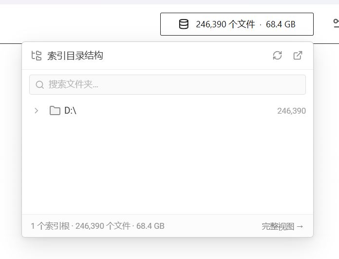
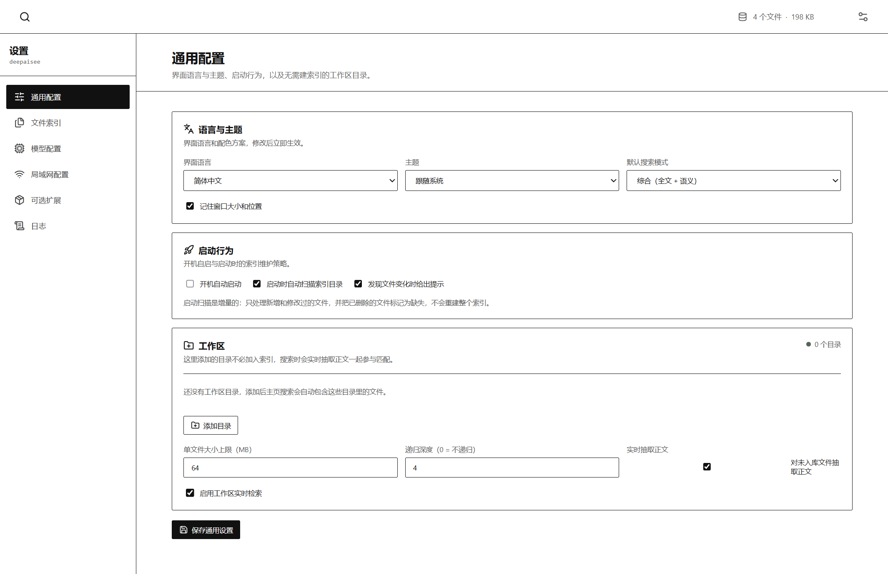
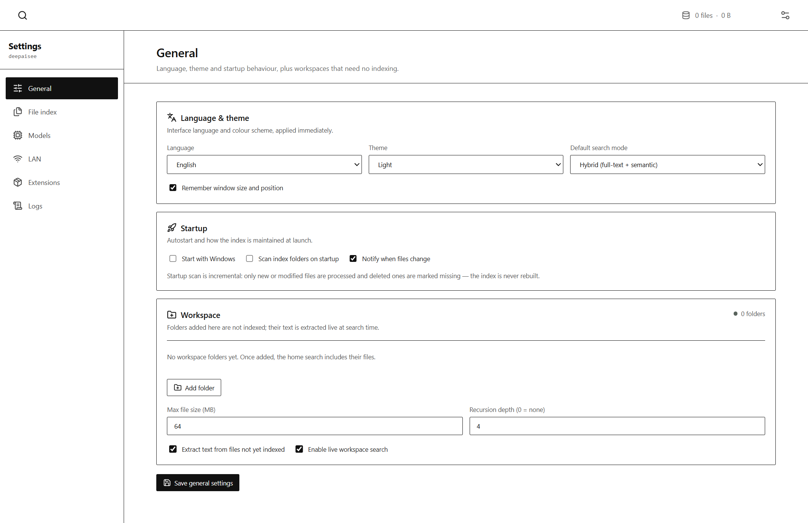
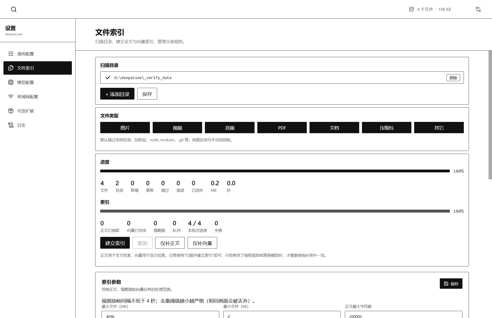
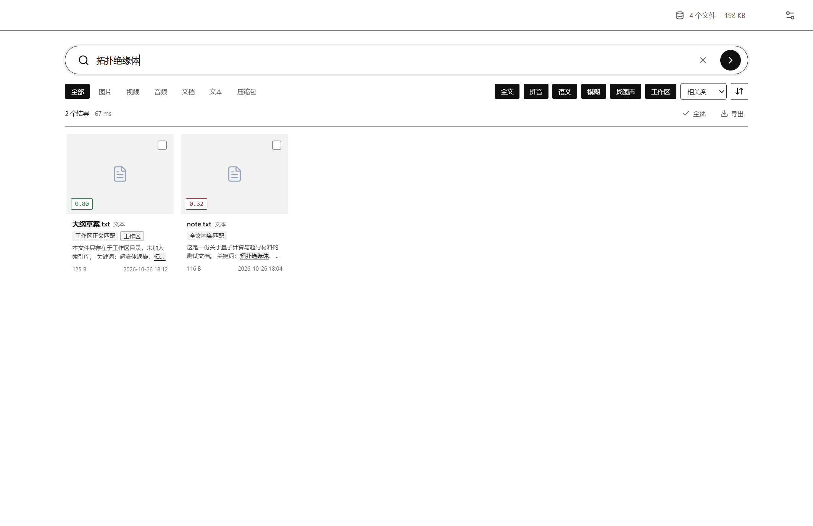
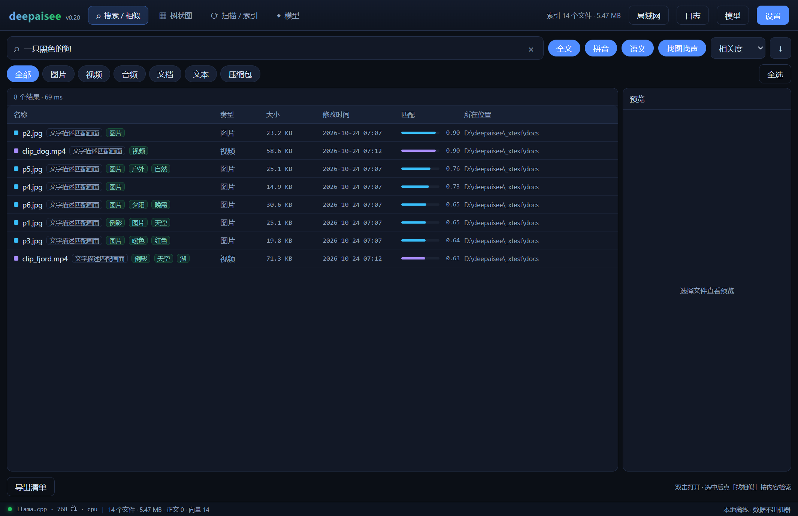
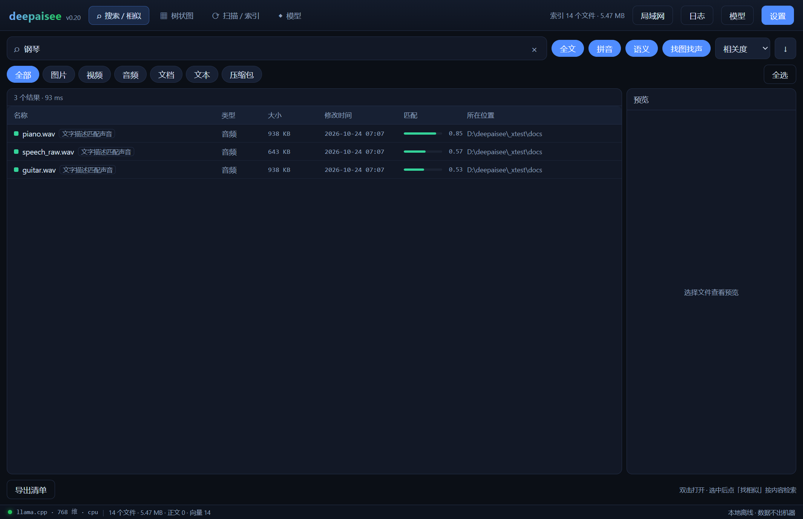
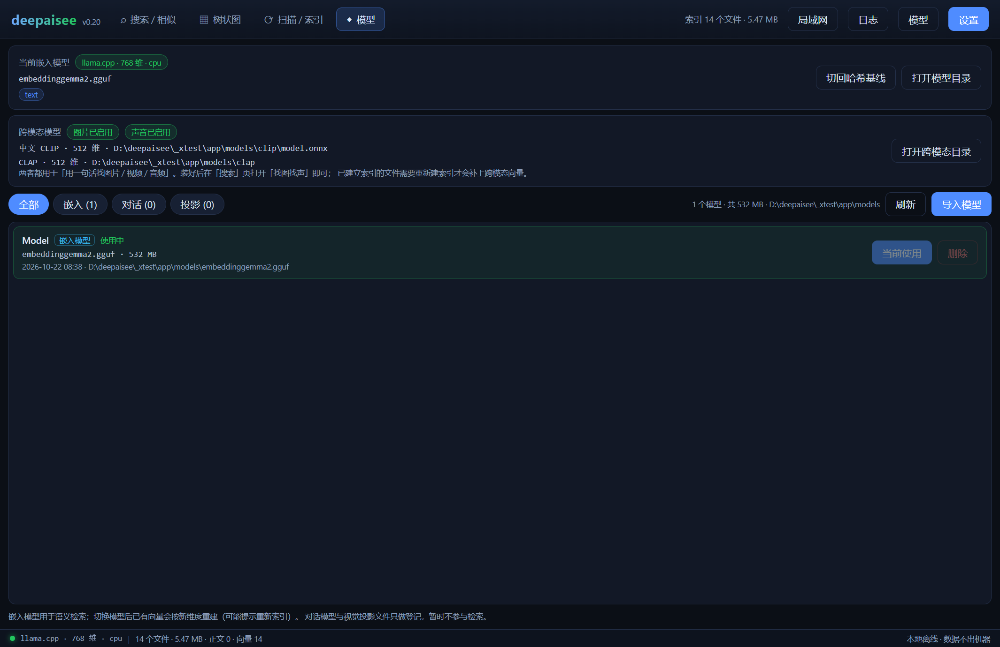
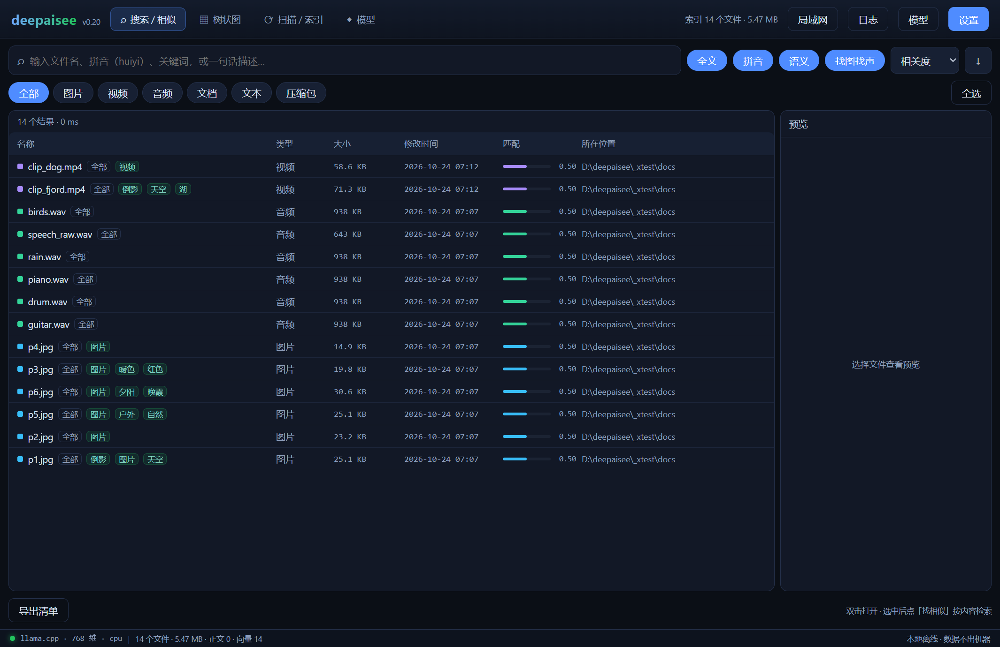

# DeepDark_Oracle · AI 磁盘智搜

本地离线的**磁盘全文 + 语义检索**桌面工具。用一句中文找到硬盘里的文件，不上传任何数据。

- 后端：**Rust + Tauri 2.0**（系统 WebView2，安装包 20MB 级，不是 Electron）
- 前端：**Vue 3 + Vite**
- AI 引擎：**llama.cpp（C++，GGUF）** 跑文本嵌入；**ONNX Runtime** 跑 CLIP（图文）与 CLAP（音文）
- 检索：SQLite FTS5 全文 + 中文 2-gram + 拼音全拼/首字母 + 模糊匹配 + 向量语义融合 + 跨模态检索
- 正文抽取：TXT / Markdown / Word（docx + doc）/ Excel（xlsx + xls）/ PPT（pptx + ppt）/ PDF / RTF / EPUB / ODF
- 界面：搜索 / 相似、树状图、扫描 / 索引、模型管理 四模式

当前版本 **v0.22**，版本历史见 [CHANGELOG.md](CHANGELOG.md)。

---

## 一、快速开始

### 0. 这个仓库里有什么

| 内容 | 位置 | 说明 |
| --- | --- | --- |
| **安装包** | ❌ 不随仓库分发（682 MB，超过 GitHub 限制） | 本地构建产物为 `release/DeepDark_Oracle_0.0.22_x64-setup.exe`，用 `npm run tauri:release` 生成，产物在 `src-tauri/target/release/bundle/nsis/` |
| **可直接运行的便携版** | 根目录：`DeepDark_Oracle.exe` + 5 个 `.dll` + 启动器 | 缺模型与 ffmpeg，见下节 |
| **前端源码** | `src/`（23 个文件，Vue 3 + TS） | 约 5,900 行 |
| **后端源码** | `src-tauri/src/`（30 个 `.rs`） | 约 15,000 行 |
| **构建配置** | `src-tauri/{Cargo.toml,​build.rs,​tauri.conf.json}`、`package.json` 等 | — |
| **验收截图** | `docs/screenshots/` | 13 张（v0.19 ~ v0.22） |
| **依赖源码** | ❌ 不含 `vendor/llama.cpp` | 需按第 2 节 clone |

### 1. 安装与运行

**方式 A：安装包（推荐给普通用户）**

运行构建好的 `DeepDark_Oracle_0.0.22_x64-setup.exe`。安装向导会让你选择安装目录，**默认落在非系统盘的 `D:\Apps\DeepDark_Oracle`**（D 盘不存在时退到 `E:\Apps`，再不行才用 `%LOCALAPPDATA%\DeepDark_Oracle`），避免把几百 MB 的模型塞进 C 盘。安装包会自动带上全部运行时 DLL、`models\`（嵌入/CLIP/CLAP）与 `tools\bin\ffmpeg.exe`，并创建开始菜单与桌面快捷方式；卸载入口在「设置 → 应用」里。

**方式 B：便携版（解压即用）**

```
DeepDark_Oracle 启动器.cmd     ← 带菜单的启动器
DeepDark_Oracle.exe            ← 直接运行，跳过菜单
```

**启动器**（`DeepDark_Oracle 启动器.cmd` + `launcher.ps1`）提供六个入口：

| 选项 | 作用 |
| --- | --- |
| `[1]` 正常启动 | 打开主界面，自动加载模型，并显示上次模型加载耗时 |
| `[2]` 自检 | 跑一遍端到端检查（配置/库/模型/向量化/全文/拼音/文件名/语义/找相似/目录/标签），结果带颜色回显 |
| `[3]` 重建索引 | 全量重抽正文 + 重算向量 + 重打画面标签 |
| `[4]` 扫描目录 | 输入一个目录，命令行方式扫描入库（带进度） |
| `[5]` 命令行 | 查看 `--cli` 全部子命令 |
| `[6]` 打开数据目录 | 索引库、向量库、缩略图、日志 |

启动器用 PowerShell 写（`launcher.ps1`），因为 **.bat 里放中文会被 cmd 按 GBK 解析坏**。`launcher.ps1` 必须保持 **UTF-8 with BOM + CRLF**，否则 Windows PowerShell 5.1 会报解析错误。

首次启动会自动加载模型（约 0.5~1.5 秒）。**便携版**的数据写在 exe 同级的 `data\`，整个文件夹可以拷走；**安装版**如果 exe 所在目录不可写（例如装在 `D:\Apps`、`Program Files` 且当前用户没有写权限），程序会自动回退到 `%LOCALAPPDATA%\DeepDark_Oracle\data`，启动器的「打开数据目录」会跟着指向实际位置。

运行时必须一起带的文件（少一个就起不来或功能缺失）：

| 文件 | 作用 | 缺了会怎样 |
| --- | --- | --- |
| `DeepDark_Oracle.exe` | 主程序 | — |
| `WebView2Loader.dll` | WebView2 装载器 | **双击无反应、退出码 `0xC0000135`** |
| `libstdc++-6.dll` / `libgcc_s_seh-1.dll` / `libwinpthread-1.dll` | gnu 运行时（llama.cpp 是 C++） | 弹「系统错误」窗后退出 |
| `onnxruntime.dll` | ONNX 推理引擎（13.5MB） | 文字找图/找声音不可用（自检里两项标 `[FAIL]`） |
| `models\embeddinggemma2.gguf` | 嵌入模型（533MB） | 退化成哈希基线，语义检索精度大幅下降 |
| `models\clip\` | CLIP 图文模型（183MB） | 文字找图片/视频停用，退回颜色特征 |
| `models\clap\` | CLAP 音文模型（155MB） | 文字找声音停用，退回频谱特征 |
| `tools\bin\ffmpeg.exe` | 抽帧 / 音频解码 | 视频缩略图与音频/视频向量失败 |
| `launcher.ps1` / `DeepDark_Oracle 启动器.cmd` | 启动器（可选） | 不影响主程序，只是少了菜单 |

> 安装包已把上表所有文件打进安装目录，不需要单独准备；下面的「不含模型」只针对 Git 仓库里的便携版。

> 表格里带体积的 4 项**不在本仓库**（超过 GitHub 100MB 单文件限制），要自己补，见下节。

验证办法：`DeepDark_Oracle.exe --selftest`，看 `selftest.txt` 末尾是不是 `失败 0 项`。库里还没索引文件时，检索类检查会标成 `[SKIP]` 而不是失败 —— 此时先把「扫描 / 索引」页的目录扫进来再跑一次。

### 关于本仓库不含模型

GitHub 单文件硬上限 100MB，下面这些放不进 Git，**需要自己补**（缺了不会崩，只是对应功能降级，见上表最后一列）：

| 文件 | 体积 | 从哪来 |
| --- | --- | --- |
| `models\embeddinggemma2.gguf` | 533MB | HuggingFace 上 EmbeddingGemma 300M 的 GGUF 转换版 |
| `models\clip\model.onnx` + `vocab.txt` | 183MB | `Xenova/chinese-clip-vit-base-patch16` 的 `onnx/model_quantized.onnx` 改名为 `model.onnx`，词表取同目录 `vocab.txt` |
| `models\clap\audio_model.onnx` + `text_model.onnx` + `vocab.json` + `merges.txt` | 155MB | `Xenova/clap-htsat-unfused` 的两个 `onnx/*_model_quantized.onnx`，词表 `vocab.json` 与 `merges.txt` 原样保留（**不要改名**） |
| `tools\bin\ffmpeg.exe` | 84MB | 任意 Windows 版 ffmpeg（需要 `-ss` 抽帧与 `f32le` 解码，7.x 已验证） |

文件放到位后不用改配置（主程序、`--selftest`、`--cli` 用同一套自动探测）：程序启动时会在 exe 同级 `models\`（其次数据目录 `models\`）下找 `.gguf` 自动装载，CLIP/CLAP 默认读 `<exe>\models\clip` 与 `<exe>\models\clap`。跨模态模型首次装好后需要**重建一次索引**才会产出 512 维图文/音文向量。

### 2. 源码运行

**先把 llama.cpp 源码放到 `vendor/llama.cpp`**（不入库，需 clone）：

```bat
git clone --depth 1 https://github.com/ggml-org/llama.cpp vendor/llama.cpp
```

v0.22 验证的是 llama.cpp `0.7.0-dev`（master，`LLAMA_VERSION_MAJOR/MINOR/PATCH = 0/7/0`）。上游 `llama.h` 的 C ABI 在小版本间会有增删，换版本后请先确认 `src-tauri/native/llama_shim.cpp` 用到的符号（`llama_model_load_from_file` / `llama_init_from_model` / `llama_batch_get_one` / `llama_get_embeddings_seq` / `llama_memory_clear` / `llama_model_n_embd_out`）仍在。

Windows 开发机可运行一次性依赖脚本安装 Rust MSVC 工具链、CMake、Ninja，拉取固定版本并恢复 npm/Cargo 依赖：

```powershell
powershell -ExecutionPolicy Bypass -File scripts/bootstrap-windows.ps1
. .\scripts\activate-local.ps1
```

便携开发依赖和缓存默认位于项目 `.tools/`，Rust 构建输出位于 `src-tauri/target/`；`.tools/` 已加入忽略规则，不会提交工具二进制。Visual Studio C++ Build Tools、Windows SDK 和 NVIDIA 驱动仍需系统安装；CUDA Toolkit 可放在 `.tools/cuda/`，也可使用已有系统安装。新开的 PowerShell 窗口需再次执行第二条激活命令。

ONNX Runtime 也可以安装到项目目录（不会写入系统目录）：

```powershell
powershell -ExecutionPolicy Bypass -File scripts/install-onnxruntime.ps1
```

脚本优先复用项目根目录已有的 `onnxruntime.dll`，否则下载 CPU 版 NuGet 包到 `.tools/onnxruntime/`。也可以用 `DEEPAISEE_ORT_DLL` 指定便携版 DLL。ONNX Runtime 执行的是 `.onnx` 模型，不能直接读取 `.safetensors` 权重；后者需要先导出 ONNX 或使用 Python/Candle 后端。

`--features llama` 会通过 `src-tauri/native/CMakeLists.txt` 把 `vendor/llama.cpp` 编成静态库。源码构建默认启用轻量的 llama.cpp；需要加载 safetensors 时加上 `candle`，发布给带 NVIDIA CUDA 的用户时把 Candle CUDA 一起编进同一个 exe（见下方发布命令）。CUDA 不是运行时下载的插件：Candle 的 CUDA kernel 在构建期需要 CUDA Toolkit/nvcc，应用运行时只负责选择具体 GPU。
如果只想跑「不含本地推理」的部分，可以加 `--no-default-features`，此时会退化成哈希基线。

```powershell
# 每个新终端先激活项目内工具和缓存路径
. .\scripts\activate-local.ps1
npm ci
npm run tauri dev
```

**工具链要求**（Windows）：

| 组件 | 版本 | 说明 |
| --- | --- | --- |
| Rust | 1.77.2+ | 推荐目标 `x86_64-pc-windows-msvc` |
| Visual Studio C++ Build Tools | 2022 | MSVC 编译器和 Windows SDK |
| Node.js | 20+ | 前端构建 |
| CMake + Ninja | 3.20+ | 编 llama.cpp |

MSYS2 UCRT64/GCC 仅用于非 CUDA 的 GNU 构建；CUDA 需要 MSVC。若 MSYS2 装在非默认路径，设环境变量：

```bat
set DEEPAISEE_UCRT64_BIN=D:\your\msys64\ucrt64\bin
```

### 3. 构建发布版

常规发布直接运行项目内脚本即可。它会自动检测 `.tools/cuda/` 或系统 CUDA Toolkit：找到时生成包含 llama.cpp CUDA 与 Candle CUDA 的单一 exe，运行时再由设置页选择具体显卡；找不到时生成不含 CUDA kernel 的原生 Candle/llama.cpp 版本。

```powershell
powershell -ExecutionPolicy Bypass -File scripts/build-release.ps1
```

也可以直接运行 `npm run tauri:release`；脚本会在项目目录或系统中找到 CUDA Toolkit 时自动把 Candle CUDA 集成进同一个 exe，并在没有 Toolkit 时生成不含 CUDA kernel 的原生版本。

需要额外传给 Tauri 的参数可以继续放在脚本后面，例如 `--bundles nsis`。

也可以显式使用 CUDA feature 构建：

```powershell
npm run tauri build -- --features llama,candle,candle-cuda,custom-protocol
```

上面的发布命令会把 llama.cpp、Candle 和 Candle CUDA 后端编译进同一个安装包。它不要求用户在安装后选择 Cargo feature；用户只在设置页选择系统中可用的显卡，运行时按所选设备建立 Candle/llama.cpp 上下文。NVIDIA CUDA 版的构建机需要兼容的 CUDA Toolkit，并从 MSVC 开发终端构建。Toolkit 可解压/安装在项目 `.tools/cuda/`，或使用系统安装；先激活本地环境会自动探测两者：

```powershell
. .\scripts\activate-local.ps1
$env:DEEPAISEE_CUDA = '1'
npm run tauri build -- --features llama,candle,candle-cuda,custom-protocol
```

验证记录：

- **v0.22（GNU / MSYS2 UCRT64）**：本机无 MSVC，用 `x86_64-pc-windows-gnu` + MSYS2 UCRT64 的 gcc 16.2 / cmake 4.4 / ninja 1.13 完整跑通 `cargo check` 与 `cargo build --release`，并产出 682 MB 的 NSIS 安装包。GNU 工具链有两条硬约束：① 中文路径会让 `windres` 打不开 `.ico`、让 MinGW `ld` 找不到标准库，`CARGO_HOME` / `RUSTUP_HOME` / `CARGO_TARGET_DIR` / `TMP` 必须全在纯 ASCII 目录（项目本身可用 `subst` 映射盘符后构建）；② 依赖 `dlltool.exe` / `windres.exe`，`PATH` 里要有 `<msys64>\ucrt64\bin`。构建命令：`cargo build --release --no-default-features --features llama,candle,custom-protocol`。
- **CUDA（MSVC）**：已在 CUDA Toolkit 13.1 + Visual Studio 2022/MSVC 下完成 CUDA Release 编译和链接。直接运行 Cargo 构建时，可执行文件位于 `src-tauri/target/release/DeepDark_Oracle.exe`。CUDA 运行仍需要驱动和 CUDA/cuBLAS 运行时 DLL，应用会优先从项目 `.tools/cuda/` 或安装目录加载，不会替用户改系统磁盘布局。没有 NVIDIA CUDA 的机器仍可使用同一个 exe 的 llama.cpp/Vulkan 路径；Candle 模型会报告当前设备不可用，而不会悄悄回退到 CPU。

**`custom-protocol` 这个 feature 不能漏**。它由 `tauri-build` 在构建脚本里读到，决定前端资源是「从磁盘内嵌协议加载」还是「连 `http://localhost:1420` 的开发服务器」；漏了这个 feature 也能编过，但打出来的 exe 双击后是**白屏**（只在 debug 下连 dev server，release 下没有服务器可连）。

---

## 二、界面结构

首页默认显示打字机标题和胶囊搜索框；输入后搜索栏收缩到顶部，结果以按相关度排序的图库卡片显示，并保留类型筛选、全文/拼音/模糊/语义/跨模态开关、相似检索、预览、定位和导出。顶栏右侧显示索引文件数与占用大小，**点击它从按钮下方弹出「索引目录结构」面板**（见下节），再往右的齿轮进入设置。

设置页的左栏分为六个标签：**通用配置**（语言、主题、启动行为、工作区目录）、**文件索引**（扫描、索引参数、规则和数据库维护）、**模型配置**（GGUF、GPU 设备、上下文、CLIP/CLAP）、**局域网配置**（服务与实时监控）、**可选扩展**和**日志**（活动记录）。每个标签只提交自身的配置片段，避免修改一项覆盖其它设置。

通用配置里的**界面语言**支持简体中文与 English：保存后整个界面（顶栏、搜索页、六个设置标签、各类提示与报错前缀）会立即切换，重启后沿用上次选择；主题可选明亮 / 暗色 / 跟随系统，切换同样即时生效。

搜索页的细节：
- 五个开关控制检索通道：**全文**（文档正文）、**拼音**（`huiyijilu` / `hyjl` → 会议记录）、**找图找声**（一句话找图片/音频/视频）、**语义**（一句话找意思相近的文件）、**工作区**（把工作区目录里还没建索引的文件也现场抽取正文一起检索）
- 类型 chip（全部/图片/视频/音频/文档/文本/压缩包）即时筛选
- 排序支持相关度/名称/大小/修改时间/类型，点击表头可切换升降序
- 右侧预览面板显示缩略图、元信息、正文片段
- 正文命中的结果会在标题下显示**加粗高亮的片段**，前后各留 60 字上下文
- 选中结果后可导出清单（CSV / TXT / JSON）

### 右上角「索引目录结构」面板（v0.22 新增）

> 顶栏那个「143,522 个文件 · 54.5 GB」的统计按钮现在可以点了。点开从按钮正下方弹出 400px 宽的下拉面板，直接看索引库里有什么，**不触发任何磁盘扫描**。

<p align="center"><br><sub>索引目录结构面板：点顶栏统计按钮从下方弹出，根节点是索引根，展开即按层查询索引库</sub></p>

| 区域 | 内容 |
| --- | --- |
| 顶部栏 | 标题「索引目录结构」+ 刷新 + 在资源管理器中打开 + 极小搜索框（按目录名过滤） |
| 主体 | 根节点是索引根（如 `D:\`），逐层展开子目录与直属文件；行高 28px，文件夹灰线图标、文件按后缀分类型图标 |
| 底部栏 | 「当前目录包含 12 个子文件夹，340 个文件 · 22.7 GB」；根层显示「N 个索引根 · X 个文件 · 大小」 |

- **按层懒加载**：展开哪层才查哪层（`tree_browse`），已加载的层缓存在前端，收起面板不销毁、再开直接复用。
- **搜索**：输入关键字按目录名匹配（`tree_search`），命中高亮 `#E6F7FF` 背景 + 加粗，点结果自动逐级展开祖先并滚动定位。
- **右键菜单**：打开文件位置 / 复制完整路径 / 复制文件名 / 加入工作区。
- **状态点**：文件行右侧 6px 小圆点，绿色=已索引、灰色=未索引、红色=索引出错。
- **收起**：点击面板外部或按 `Esc`；底栏右侧「完整视图 →」切到原来的树状图页（squarify 面积图）。
- 视觉：白底 `#FFFFFF`、主文字 `#333333`、次要 `#999999`、边框 `#CCCCCC`、选中 `#F5F5F5`、搜索命中 `#E6F7FF`；暗色主题有独立的一套变量。
- 后端：`tree_browse` / `tree_search` / `workspace_add` 三个 Tauri 命令；数据层用 `dir >= lo AND dir < hi` 的字符串区间做前缀裁剪，14 万文件的库上全量聚合 140ms、单层展开 40~50ms。

### 界面截图

<table>
<tr>
<td width="50%"><br><sub>通用配置：语言 / 主题（含跟随系统）/ 启动行为 / 工作区目录</sub></td>
<td width="50%"><br><sub>English 界面：语言切换即时生效，六个设置标签与搜索页全部英文</sub></td>
</tr>
<tr>
<td width="50%"><br><sub>文件索引：视频抽帧间隔、最大帧数、去重阈值、索引音轨</sub></td>
<td width="50%"><br><sub>工作区检索：未入库的文件现场抽正文，命中带「工作区」标签</sub></td>
</tr>
<tr>
<td width="50%"><br><sub>文字找图：「一只黑色的狗」→ 命中真实照片，视频按首帧参与匹配</sub></td>
<td width="50%"><br><sub>文字找声音：「钢琴」→ 命中钢琴音频，纯画面查询不会串到声音</sub></td>
</tr>
<tr>
<td><br><sub>模型管理页：扫描模型目录、一键切换、查看维度与路径</sub></td>
<td><br><sub>全文检索：正文命中的片段直接显示在标题下方</sub></td>
</tr>
<tr>
<td colspan="2" align="center"><br><sub>索引目录结构面板（v0.22）：顶栏统计按钮点开，按层读取索引库的目录树</sub></td>
</tr>
</table>

> 截图为开发机上的实测记录，列表里的「所在位置」是测试目录。

### 全文搜索支持哪些格式

| 类别 | 扩展名 | 抽取方式 |
| --- | --- | --- |
| 纯文本 | txt md log csv tsv json xml yaml ini cfg conf html css js ts vue … | 直接解码，自动识别 BOM / UTF-8 / GB18030 |
| Word | docx、**doc** | docx 解 `word/document.xml`；doc 自写 OLE2 + Word 97 分片表解析 |
| Excel | xlsx、**xls** | xlsx 读 sharedStrings + 各 sheet；xls 解 BIFF8 的 SST / LABELSST / NUMBER / RK |
| PPT | pptx、**ppt** | pptx 取各页 `a:t`；ppt 解 OLE2 记录树里的 TextCharsAtom / TextBytesAtom |
| PDF | pdf | `pdf-extract`（扫描件无文字层，抽不出来） |
| 其它 | rtf、epub、odt/ods/odp | RTF 控制字解码；EPUB 解 zip 内 xhtml；ODF 读 `content.xml` |

单文件正文上限由 `index.max_text_chars` 控制（默认 20 万字符），超出截断。

---

## 三、检索是怎么打分的

| 来源 | 分值 | 说明 |
| --- | --- | --- |
| 文件名完全相等 | 1.00 | 忽略大小写 |
| 文件名前缀命中 | 0.92 | |
| 文件名包含 | 0.72 + 0.26 × 覆盖率 | 覆盖率 = 查询词占文件名比例 |
| 路径命中 | 0.50 ~ 0.65 | 命中越靠前分越高 |
| 拼音全拼 / 首字母 | 0.70 ~ 0.97 | 仅纯字母查询且文件名含中文 |
| 模糊匹配 | 0.35 ~ 0.70 | Jaro-Winkler ≥ 0.80 才计分 |
| 全文 FTS5 | 0.90 × 归一化相关度 | 命中即得 35% 底分，避免长文档被压没 |
| 语义向量 | + 0.55 × 1.6 × 归一化相似度 | 扣掉噪声底 0.48 后再归一 |
| CLIP 图文相似 | 0.55 ~ 0.90 | 余弦 < 0.25 丢弃，0.25→0.55、0.45→0.90 线性映射 |
| CLAP 音文相似 | 0.52 ~ 0.88 | 余弦 < 0.16 丢弃，0.16→0.52、0.46→0.88 线性映射 |

最终按分数降序，低于 0.16 的丢弃（纯向量查询不设阈值）。多个来源同时命中时取最高分，不叠加（语义分量与跨模态分量是加分项，会额外累加，但只在原分更低时生效）。

正文命中的结果会把命中位置前后 60 字做成片段返回，前端用 `<mark>` 高亮显示。

### 中文全文检索为什么要特殊处理

SQLite 自带的 `trigram` 分词器要求 token 至少 3 个字符，**中文两字词（「余弦」「会议」）永远搜不到**。所以这里用 `unicode61` 分词器，入库前先把中文切成重叠的 2-gram（`余弦相似度` → `余弦 弦相 相似 似度`），原文另存一列 `raw` 供片段展示。查询侧做同样的切分，用 `"余弦" OR "弦相" OR ...` 去匹配。

### 向量检索

`<数据目录>\vectors\`（文本，llama.cpp **768 维**）、`vectors_media\`（颜色/频谱兜底，256 维）、`vectors_clip\`（图片与视频首帧，**512 维**）、`vectors_audio\`（音频，**512 维**）四个空间各自一个 `vectors.bin` + `ids.bin`。检索是暴力点积 + 排序，十万条以内都是毫秒级。

任一空间的维度变了（换嵌入模型 / 换跨模态模型）会**自动清空重建**该空间，旧的向量不会污染新模型 —— 但这也意味着换模型后要重新索引一次。

---

## 四、文字找图 / 找声音（跨模态）

「用一句话找到硬盘里的图、音频、视频」由两个独立的小模型完成，和主嵌入模型互不影响：

| 模型 | 目录 | 体积 | 作用 |
| --- | --- | --- | --- |
| Chinese-CLIP（量化） | `models\clip\` | 182MB | 文字 ↔ 画面 |
| CLAP（量化） | `models\clap\` | 154MB | 文字 ↔ 声音 |

两者都走 **ONNX Runtime**（`onnxruntime.dll` 就放在 exe 旁边），推理在本机 CPU 完成，不上传任何数据。

| 能力 | 状态 |
| --- | --- |
| 文件名 / 路径 / 拼音 / 模糊 / 全文搜索 | ✅ 完整支持 |
| 文字描述做语义搜索（找文档、代码、笔记） | ✅ 支持 |
| 文字描述找图片 / 视频画面 | ✅ 支持（CLIP，512 维图文对齐） |
| 文字描述找声音 | ✅ 支持（CLAP，512 维音文对齐） |
| 图片找相似图片 | ✅ 支持（CLIP 特征，512 维） |
| 音频找相似音频 | ✅ 支持（CLAP 特征，512 维） |
| 视频找相似视频 | ✅ 支持（首帧 CLIP 特征） |

### 怎么用

1. 搜索框里直接输入一句描述（**2 个字以上**），右侧打开「找图找声」开关；
2. 结果里会出现「文字描述匹配画面」「文字描述匹配声音」的原因标签；
3. 选中任意图片/音频/视频点「找相似」，就在**同一模态**里找最近的邻居。

音频提示词建议用**具体名词**：「钢琴」「下雨的声音」「打鼓」「鸟叫」「弹吉他」。中文会先映射成英文提示词再送进 CLAP（该模型是英文语料训练的），映射表有四十来条常用音效，没命中的中文会原样送入，效果会差一些。

### 一句描述同时能当画面也能当声音时怎么办

两个模型对不相干的内容都会硬给一个不低的余弦（CLIP 随便配都 0.30，CLAP 只有 0.13），只靠绝对阈值会让两边互相串味 —— 「钢琴」会带出几张图片，「一只黑色的狗」会带出几段音频。所以每个空间先算**突出度**（第一名余弦减去该空间的中位数），抬升不足 0.05 就认为这个空间对这句话「无话可说」，整段丢弃。

另外按意图分流：查询里出现声音词表里的词（钢琴、打鼓、鸟叫、下雨……）时 CLAP 说了算、CLIP 让路；反过来纯画面描述里 CLAP 要突出得多才准插话。实测「钢琴」→ piano.wav、「一只黑色的狗」→ p2.jpg / clip_dog.mp4、「峡湾和湖泊」→ p1.jpg / clip_fjord.mp4 都是干净的首位命中，不再混入另一种模态。

### 代价与前提

- 首次索引时要为每个媒体文件跑一次模型：图片 ~30ms、音频 ~200ms（要解 10 秒 48kHz 波形 + 算 mel）、视频 ~50ms（抽首帧）。老库升级后需要**重建一次索引**才会出现新结果。
- 音频需要 `tools\bin\ffmpeg.exe`；视频同理（抽帧）。没有 ffmpeg 时视频跳过并提示，不会卡住。
- 两个模型都可以在「模型」页单独关闭，关掉后该模态退回颜色特征（256 维），文字找图/找声即失效。

### 为什么不用主嵌入模型做

EmbeddingGemma 2 的视觉塔（`vision_tower`）在 llama.cpp 里没有可用的 embedding 通路。我们试过用 mtmd 导出视觉塔并编码图片（向量确实是 512 维、不同图片也不同），但视觉塔输出与文本塔的 768 维**不在同一语义空间**（实测图文余弦 0.03~0.09，毫无区分度），真正负责对齐的 `embed_vision.embedding_projection` 层没有被 `convert_hf_to_gguf.py` 导出。详见 [CHANGELOG.md](CHANGELOG.md) 的 v0.17 条目 —— 所以跨模态单独接了 CLIP/CLAP。

### 画面标签（不依赖模型，两条腿走路）

即使关掉 CLIP，索引图片/视频时仍会用视觉统计（HSV 分布、亮度、上下半区构图、边缘密度）生成一批**中文画面标签**写进 `files.tags`，命中一个标签 0.62 起、上限 0.82。词表约四十个：

- 色系：`蓝色` `绿色` `暖色` `红色` `白色` `黑色` `灰色` `黑白` `单色`
- 场景：`蓝天` `蓝天白云` `白云` `天空` `海洋` `水` `湖` `倒影` `森林` `树木` `草地` `草原` `自然` `户外` `风景` `雪景` `冰雪` `雪山`
- 时间/光线：`夕阳` `黄昏` `晚霞` `日落` `夜景` `明亮`
- 用途/构图：`纯色` `背景图` `壁纸` `截图` `文档` `照片` `色彩鲜艳`

统计特征回答不了「画面里有什么物体」，这类描述交给 CLIP。

---

## 五、命令行

发布版 exe 自带 CLI，在 cmd / PowerShell 里直接调用（GUI 双击运行不受影响）。

```bat
:: 扫描目录并入库（可给多个目录）
DeepDark_Oracle.exe --cli scan D:\照片 E:\资料

:: 建立索引（--wait 阻塞到跑完；--what 可选 auto | text | embed）
DeepDark_Oracle.exe --cli index --wait

:: 混合检索：文件名 / 路径 / 拼音 / 全文 / 语义一起打分
DeepDark_Oracle.exe --cli search "会议纪要"
DeepDark_Oracle.exe --cli search "余弦" --limit 5
DeepDark_Oracle.exe --cli search "forest" --kind image

:: 纯语义检索（一句话描述）
DeepDark_Oracle.exe --cli sem "怎么比较两段文字的相似程度"

:: 找同类型相似文件
DeepDark_Oracle.exe --cli similar "D:\照片\forest.png"

:: 库统计
DeepDark_Oracle.exe --cli stats

:: 分类规则 / 局域网服务
DeepDark_Oracle.exe --cli rules
DeepDark_Oracle.exe --cli serve --port 8770
```

输出示例：

```
搜索「余弦」：1 条，2 ms
------------------------------------------------------------------------------
 0.31  文本        328 B  vector_search.py
        <临时目录>\ds-test\code\vector_search.py
        余弦相似度检索：把查询向量与库里每条向量做点积 …
```

几个注意点：

- 程序是 windowed 版（没有控制台窗口），CLI 靠 `AttachConsole` 挂到调用它的终端上。**从资源管理器双击 exe 不会出现命令行窗口**，符合双击打开 GUI 的预期。
- `--cli` 必须写在最前面；子命令后面的参数按上文顺序给即可。
- 退出码：`0` 成功，`1` 运行错误（模型缺失、文件不在索引里等），`2` 用法错误。
- 想给脚本解析结果时，用 `--cli stats` 的稳定文本格式，或直接读 `data\index.db`（SQLite）。

---

## 六、数据目录

**便携版**在 exe 同级 `data\`；**安装版**在安装目录不可写时自动回退到 `%LOCALAPPDATA%\DeepDark_Oracle\data`（探测顺序：exe 同级 → LOCALAPPDATA → APPDATA → TEMP）。目录结构一致：

> WebView2 的用户数据目录是**单独一套**（不属于上表）：优先 exe 同级 `webview-data\`，其次 `<数据目录>\webview\`，最后 `%LOCALAPPDATA%\DeepDark_Oracle\webview`；会自动挑第一个可写且不在 C 盘的位置。排障时可用环境变量 `WEBVIEW2_USER_DATA_FOLDER` 强制指定。

> **插件扩展目录**：安装版会在安装根目录创建 `plugins\`（随包带一份说明文件），卸载时**保留**该目录；程序里的 `config\plugins_dir()` 已经指向它，后续插件把目录或压缩包放进去即可被发现。

```
data\
├─ config.json          配置（模型路径、扫描目录、索引参数）
├─ index.db             SQLite（files 表 + FTS5 全文索引）
├─ vectors\             文本向量（llama.cpp）
├─ vectors_media\       媒体兜底向量（颜色/频谱哈希，256 维）
├─ vectors_clip\        图片与视频帧融合向量（CLIP，512 维；视频取多帧平均）
├─ vectors_audio\       音频向量（CLAP，512 维）
├─ thumbs\              缩略图
├─ tmp\                 抽帧临时目录（正常时为空）
├─ autoload.log         模型自动加载日志
└─ panic.log            崩溃信息（正常时不出现）
```

---

## 七、模型管理

顶栏「模型」进入独立页面，不需要再手改配置文件：

| 操作 | 说明 |
| --- | --- |
| **查看** | 列出 `<exe>\models\`（没有则用 `data\models\`）里所有 `.gguf` 与 `.safetensors`，显示大小、修改时间、格式、候选后端和是否为当前模型 |
| **筛选** | 全部 / 嵌入 / 对话 / 投影 四类；按文件名关键字自动归类 |
| **切换** | 点「设为嵌入模型」即时加载，状态栏显示实际 GPU 名称和向量维度 |
| **导入** | 从任意位置选择模型文件夹，自动识别 GGUF、EmbeddingGemma2 safetensors 及配套配置，重名自动加序号 |
| **删除** | 删除模型文件；**正在使用的模型不允许删除** |
| **切回哈希基线** | 不加载任何模型文件，秒启动，用于验证「是不是模型的问题」 |

类型判定规则（看文件名）：含 `mmproj` / `projector` / `vision` → 视觉投影；含 `embed` / `bge` / `gte` / `minilm` → 嵌入；含 `chat` / `instruct` / `qwen` / `llama-3` → 对话；其余为未知。对话模型与投影文件只登记、暂不参与检索。

同一个页面下方还有**跨模态模型**卡片：显示 CLIP / CLAP 是否已安装、目录位置、能否一键打开目录。两个模型放在 `models\clip\` 与 `models\clap\`，删掉对应目录即视为未安装（文字找图/找声自动关闭，程序不报错）。

## 八、调优

**模型路径**：`data\config.json` 的 `model.embed_model` 指向 `.gguf` 或兼容目录中的 `model.safetensors`；留空则回退「哈希基线」（不需要模型，256 维，只适合演示）。EmbeddingGemma2 safetensors 由 Candle 原生适配器加载，未知架构只标记为 Python 候选，需在设置页安装可选 sidecar。

**GPU**：模型设置页会列出当前构建实际支持的 GPU/核显，显示完整名称、总显存和空闲显存，并按显存从大到小排列。`model.gpu_device = "auto"` 默认选择显存最大的设备，并在**没有可用加速后端时自动退回 CPU 推理**（v0.21 起；状态栏会显示 `llama.cpp GGUF · CPU 推理（没有可用加速后端）`）。也可以在下拉里显式选「CPU（无可用加速设备时）」。显式指定的 GPU 失效或显存不足时同样退回 CPU，不会让整个语义检索不可用。

构建脚本会自动探测项目 `.tools/cuda/` 或系统 CUDA Toolkit 并为 llama.cpp 启用 CUDA；包含 Candle CUDA 的发布构建请使用上一节的 `--features llama,candle,candle-cuda,custom-protocol`。这会生成一个同时包含两种原生后端的 exe，运行时通过设置页选择具体 GPU。运行时需要 CUDA Runtime/cuBLAS DLL 在 `PATH` 或应用目录，Windows GNU 工具链不支持该 CUDA 路径。设置 `DEEPAISEE_CUDA=0` 可显式关闭 llama.cpp 的 CUDA 构建；Candle CUDA 编译仍需要构建时存在 Toolkit。

要让设置页列出 Intel/AMD 核显，需要把 Vulkan SDK（必须含 `Include/vulkan/vulkan.h` 和 `Bin/glslc.exe`）放到项目 `.tools/vulkan`；构建脚本会自动探测，也可显式设置 `$env:DEEPAISEE_VULKAN='1'`。项目会通过 GGML Vulkan 枚举离散 GPU 和集成 GPU；没有 Vulkan SDK 时不会伪造核显条目。设置 `DEEPAISEE_VULKAN=0` 可显式关闭自动探测。CLIP/CLAP 的 ONNX 路径目前使用 CPU Execution Provider，与 llama.cpp 文本模型的 GPU 选择相互独立。

**索引参数**：`index.max_text_chars`（单文件正文字符上限，默认 20 万）、`index.video_frames`（期望抽帧数，默认 16）、`index.video_frame_interval`（最小抽帧间隔秒，默认 4）、`index.video_max_frames`（单视频帧数上限，默认 64）、`index.video_dedup_distance`（帧指纹去重阈值，默认 6，越小越严格）、`index.video_index_audio`（是否索引视频音轨，默认开）、`index.audio_seconds`（音频取样秒数）。`ui.*` 下是通用配置（`language` / `theme` / `autostart` / `auto_scan_on_start` / `notify_file_changes` / `default_search_mode`），`workspace.dirs` 是工作区目录列表。

---

## 九、自检

**打包版（用户/验收最常用）**

```bat
:: 无界面自检，结果写到 exe 同级 selftest.txt
DeepDark_Oracle.exe --selftest
```

全绿标准是末尾 `通过 N 项，失败 0 项`（索引过真实文件时 N 为 16，空库时 8 项通过、8 项跳过）。它依次验证：读配置 → 开库 → 加载 GGUF →
文本向量化（L2 范数应为 1.000）→ 开向量库 → CLIP 模型 → CLAP 模型 → 全文 / 拼音 / 文件名检索 → 语义检索 →
文字找图 / 文字找声音 → 图片找相似 → 目录统计 → 画面标签检索。哪一步失败就说明那一段的能力不可用，文件里会写明原因。

三种行标记：`[OK]` 通过、`[FAIL]` 失败、`[SKIP]` 前置条件不满足（库里没文件 / 没图片 / 没装跨模态模型）。
**空库时会看到多项 `[SKIP]` 和末尾的「跳过 N 项」**，这是正常的：先把要检索的目录扫进来，再跑一次就是全绿。

**开发期**

```bat
:: 后端端到端（扫描→索引→全文→拼音→语义→找相似→目录树）
cd src-tauri && cargo run --example smoke --features llama
```

`smoke` 会把结果打在控制台。发布包验收用 `--selftest`。

> 其余开发探针（`claptest` / `crossprobe` / `melprobe` / `visdemo`）同样用 `cargo run --example <名字>` 运行。
> 它们放在 `src-tauri/examples/` 而不是 `src/bin/`，因为 tauri-bundler 会把 `src/bin/` 下的每个 bin 都当外部二进制打进安装包——这些探针不该出现在分发包里。

---

## 十、常见问题

**Q：启动后界面一片空白？**
A：debug 版会连 `http://localhost:1420`，必须先 `npm run dev`；或者直接用 `release` 构建的 exe。

**Q：报「系统错误」窗口一闪而过？**
A：缺 `libstdc++-6.dll`。把 `tools\msys64\ucrt64\bin\` 下的 `libstdc++-6.dll`、`libgcc_s_seh-1.dll`、`libwinpthread-1.dll` 拷到 exe 旁边。

**Q：搜索结果全是 0 条？**
A：先看底部状态栏的文件数。若为 0，去「扫描 / 索引」页添加目录再扫描；扫描完还要等索引进度跑完（底部会显示 `向量 N`）。

**Q：全文搜「余弦」搜不到，但搜「会议」可以？**
A：说明该文件的正文没被抽取。可能原因：PDF 是扫描件没有文字层、文档加密（带打开密码）、老式 `.doc` 用了不常见的分片表、或超过 `index.max_text_chars`。打开右侧预览看是否有正文片段。

**Q：输入「一只黑色的狗」搜不到图片？**
A：检查三件事：① 搜索框右侧「找图找声」开关是否打开；② `models\clip\` 里有没有 `model.onnx` 与 `vocab.txt`；③ 索引是在装好 CLIP **之后**重建的吗 —— 老索引里没有 512 维图文向量，必须重建一次才会有结果。`--selftest` 里的「文字找图 / 文字找声音」两项能直接告诉你哪一环断了。

**Q：搜「钢琴」找得到，搜「悲伤的钢琴曲」就不行？**
A：CLAP 是英文音效语料训练的，只能理解**具体声音**（钢琴、雨声、狗叫），不理解情绪与曲风。中文会先经内置映射表转成英文提示词（四十来条常用音效），没命中的中文原样送入，效果会明显变差。

**Q：视频搜不到 / 索引时报「抽帧失败」？**
A：视频要靠 `tools\bin\ffmpeg.exe` 抽首帧。缺 ffmpeg、或 `%TEMP%` 不可写时程序会改用 `data\tmp\` 并在失败时明确提示。确认 `tools\bin\ffmpeg.exe` 在发布目录里即可。

**Q：安装版装到 D:\Apps 后，索引库在哪？**
A：程序启动时会先试 exe 同级的 `data\`，写不进去（`Program Files`、`D:\Apps` 这类目录需要管理员权限）就自动回退到 `%LOCALAPPDATA%\DeepDark_Oracle\data`。启动器的「打开数据目录」按同一顺序探测，不会打开错地方。想确认实际路径：设置 → 文件索引 → 索引数据库里显示的就是真实路径。

**Q：视频抽帧是怎么做的？会不会很占空间？**
A：按 `index.video_frame_interval`（默认 4 秒）的间隔切成时间窗，每个窗口按「**场景切换点 → I 帧 → 窗口中心**」的优先级挑一帧（场景切换由 ffmpeg 的 `scene` 分数检测，I 帧由 `-skip_frame nokey` 探测），再用 64 位 dHash 指纹**加平均颜色**去重（结构汉明距离 ≤ `index.video_dedup_distance` 且颜色也接近的相邻帧才丢弃 —— 只比结构的话，纯色/黑屏/幻灯片白底这些低对比画面指纹几乎一样，「红底切绿底」会被误丢）。采样间隔还会按镜头切换密度自适应：几乎不换镜头的 PPT / 网课放稀到 1.5 倍省空间，动作片 / 体育加密到 0.5 倍，但任何情况下都不低于 4 秒。抽出来的帧只用于即时计算 CLIP/媒体向量，算完就删临时文件；库里只留**特征向量和压缩缩略图**，所以索引体积不会随视频时长线性膨胀。要更细的采样就调小间隔（下限 4 秒），要控制上限就调 `index.video_max_frames`。

**Q：视频里的说话声/音乐能搜到吗？**
A：能，前提是装了 `models\clap\` 且设置页「索引视频音轨」开着（默认开）。程序用 ffmpeg 把音轨解成 PCM，交给 CLAP 生成音频向量；无声视频会跳过而不报错。改动这个开关后需要**重建一次索引**才会产出音轨向量。

**Q：工作区目录是什么？和扫描索引有什么区别？**
A：工作区（设置 → 通用配置）指定的是「不建索引、搜索时现场读」的目录。搜索时打开工具栏的「工作区」开关，程序会遍历工作区目录里**还没入库**的文件，实时抽取正文参与匹配，结果与索引库结果一起排序（工作区命中会带「工作区」标签，缩略图显示为空）。适合放近期资料、U 盘、网络盘这类不值得建索引的地方；代价是首次搜索会慢一点（有 4 秒目录缓存与正文缓存）。

**Q：启动时会自动扫描吗？**
A：`ui.auto_scan_on_start` 默认开：程序启动 2.5 秒后在后台跑一次增量扫描，只对比修改时间，把新增/修改/删除的文件同步给索引，不会重算已有文件的向量。扫描结束若检测到变化，右下角会弹一条轻量提示（可在通用配置里关掉 `notify_file_changes`）。

**Q：装了之后语义搜索不工作 / 状态栏显示「哈希基线」？**
A：说明嵌入模型没加载成功，程序退回了 256 维哈希向量（只能做近似字面匹配）。v0.21 起 llama.cpp 在没有可用加速后端时会**自动走 CPU 推理**（状态栏显示 `llama.cpp GGUF · CPU 推理（没有可用加速后端）`），650 MB 的 `models\embeddinggemma2.gguf` 在 CPU 上也能跑，只是索引慢一些。如果仍显示哈希基线，检查 `models\embeddinggemma2.gguf` 是否随安装包放了进来（安装目录下应有 `models\` 子目录），以及模型设置页是否把它设成了当前模型。

**Q：安装时弹出「无法打开要写入的文件」或静默安装一闪而过？**
A：多见于安全软件（如火绒、360）拦截**未签名**的安装程序写目标目录或解压到 `%TEMP%`。处理办法：① 双击安装包，在安全软件弹窗里选「允许」；② 或先把安装包加入安全软件信任区；③ 静默安装（`/S`）时若 `%TEMP%` 不可写会直接退出，可先把 `TEMP`/`TMP` 指到一个可写目录再运行。
**Q：老式 .doc / .xls / .ppt 能搜吗？**
A：能，用的是内置的 OLE2 解析器（不依赖 Office）。但加密文档、以及 Word 6/95 这种更老的二进制格式不在支持范围内，会跳过并计入「抽取失败」。

**Q：树状图只显示一个大方块？**
A：正常。体积占比 99% 的目录会占满画布，其余目录在右侧列表里看。

**Q：扫描 `C:\Windows` 报「拒绝访问」？**
A：系统目录需要管理员权限。扫描时无权限的目录会被跳过并计入「错误」计数，不会中断整体扫描。

**Q：`cargo build` 报 `failed to open ...\.cargo-build-lock` / `拒绝访问 (os error 5)`？**
A：`target` 目录里有残留的锁文件，且其完整性级别高于当前进程（常见于从加固过的环境里带出来的 `target`）。不用改 ACL，直接换一个构建目标目录即可：

```bat
set CARGO_TARGET_DIR=D:\build\DeepDark_Oracle
cd src-tauri && cargo build --release --features llama,custom-protocol
```

**Q：打出来的 exe 双击白屏？**
A：漏了 `custom-protocol` feature。没有它 `tauri-build` 会按开发模式（`cfg(dev)`）编译，运行时去连 `http://localhost:1420`，而发布机没有 Vite。构建命令必须带 `--features llama,custom-protocol`。

---

## 十一、许可

本项目以 **MIT** 发布，见 [LICENSE](LICENSE)。第三方组件的许可与来源见 [THIRD_PARTY.md](THIRD_PARTY.md)。

需要留意的几条：
- **llama.cpp** — MIT。
- **EmbeddingGemma 模型权重** — 版权归 Google，遵守 Gemma Terms of Use。
- **Chinese-CLIP / CLAP** — Apache-2.0（权重不随仓库分发）。
- **FFmpeg** — LGPL/GPL，本项目通过独立进程调用，未静态链接。
